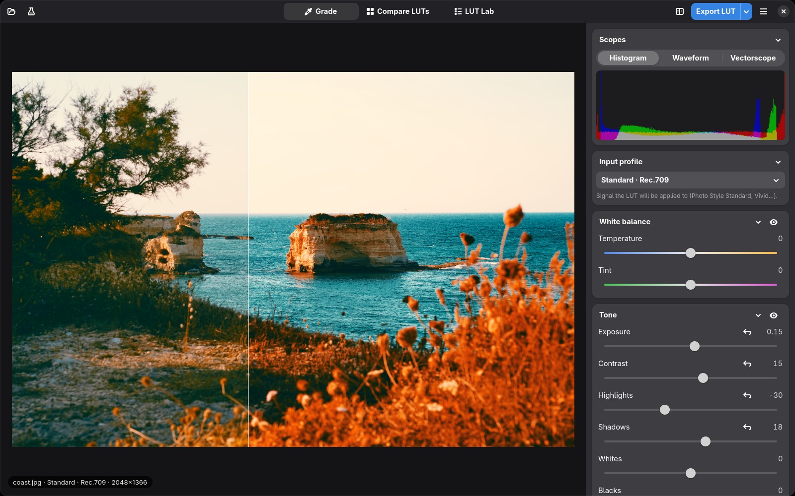
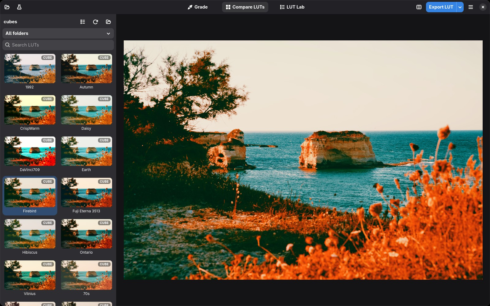
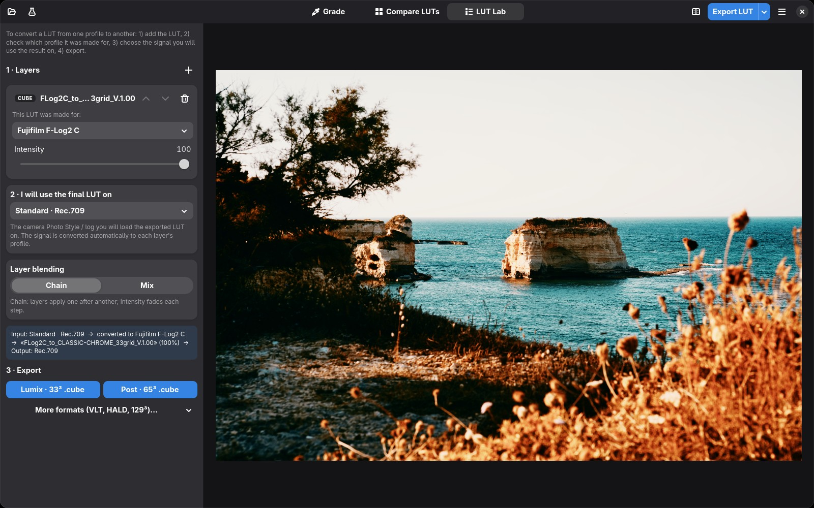
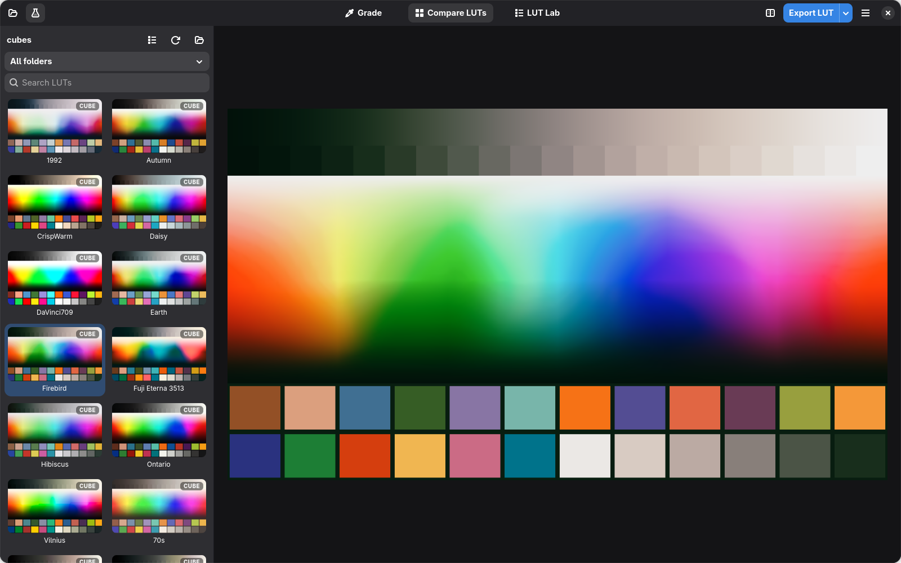

<div align="center">


# VibingLUT

### Turn any photo into a camera-ready 3D LUT.

Grade a JPEG or a camera RAW, watch the result live on the GPU, and export a `.cube`
you can load straight into your Lumix, your editor or your colour pipeline.
Free, open source, native Linux desktop app.

[](LICENSE)




</div>

---

## Why VibingLUT?

You found the look. Now you want it **in camera**, on every shot, without opening a
heavy video editor just to bake a LUT.

VibingLUT is a **3D LUT creator built around photos**. Grade a picture with
professional tools and get a mathematically exact LUT out of it, ready for in-camera
preview, video editors or other photos. It also helps with the LUTs you already have:
compare your whole collection side by side, and convert LUTs between camera log
profiles. For example, a Fujifilm F-Log LUT becomes one for Panasonic V-Log or for a
plain Standard picture profile.

- **From photo to LUT in minutes.** Open a JPEG or RAW, grade it, press `Ctrl+E`.
- **What you see is what you export.** The preview and the exported LUT come from the
  same GPU code, and the LUT is evaluated exactly at every lattice point.
- **Made for cameras.** Lumix *Real Time LUT* sizes (33³ `.cube`, 17³ `.vlt`) are one
  click away.
- **Native and fast.** Rust + GTK4/libadwaita, GPU-accelerated through Vulkan (Metal
  on macOS), no Electron and no browser engine.

---

## Features

### 🎨 Grade: build your look

- **White balance** on the CIE daylight locus with **CAT16** chromatic adaptation.
- **Tone:** exposure, contrast, highlights, shadows, whites and blacks in log space.
- **Colour:** saturation, vibrance, and saturation of shadows and highlights,
  computed in **OKLab / OKLCh**, a perceptually uniform colour space.
- **Primary colour wheels:** lift, gamma, gain and offset, each with a luma control
  (double-click to reset).
- **Selective colour:** hue, saturation and luminance for reds, oranges, yellows,
  greens, teals, blues, purples and magentas, with smooth bands that never tear
  gradients.
- **Curves:** master + R/G/B, monotone (Fritsch–Carlson) so they never overshoot.
- **Stack LUTs after the grade,** each with its own intensity. They are previewed
  live and baked into the export.
- **Bypass any section** with its eye toggle to compare with and without it.
- **Live scopes:** histogram, waveform and vectorscope.
- **Before / after split** that you can drag across the image.

### 🗂️ Compare LUTs: your whole library at a glance



Point VibingLUT at a folder (sub-folders included) and every LUT is rendered on
**your** photo as a thumbnail, with tetrahedral interpolation on the GPU. You can
search by name, filter by sub-folder, and click a thumbnail to see it full size with
a before/after split. `.cube`, `.vlt` and HALD `.png` LUTs are all recognised, with a
small badge for each format.

### 🧪 LUT Lab: combine and convert LUTs



- **Chain** LUTs one after another, or **mix** them as a weighted average in OKLab,
  each with its own intensity.
- **Retarget a LUT to another camera profile.** Tell the Lab which profile a LUT was
  made for and which signal you will use it on. The conversion is analytic: it uses
  the manufacturer log curves and gamut matrices, not a lookup approximation.
  - Use Fujifilm's F-Log / F-Log2 / F-Log2 C film simulation LUTs on a Panasonic in
    V-Log, or on a Standard profile.
  - Turn a Rec.709 look into a V-Log, S-Log3 or C-Log3 LUT, and back.
- The source profile is detected from vendor file names such as `FLog2C_to_ETERNA…`.
- A plain-language summary tells you exactly what the exported LUT will do.

### 🔬 Test chart: see what a LUT really does



Press `T` to swap the photo for a synthetic chart made of grey ramps, a full hue
sweep and the 24 ColorChecker patches. Neutrals that drift, hues that bend and skin
tones that shift become obvious instantly, in every view.

### 📤 Export

| Target | Format | Size |
|---|---|---|
| Lumix in-camera *Real Time LUT* | `.cube` | 33³ |
| Lumix / VariCam | Panasonic `.vlt` | 17³ |
| Post-production (Resolve, Premiere, FCP, OBS…) | `.cube` | 65³ |
| High precision | `.cube` | 129³ |
| Photo editors, GIMP, ImageMagick, ffmpeg `haldclut` | HALD CLUT `.png` (16-bit) | 64³ |
| Identity HALD for external tools | HALD `.png` | 64³ |

---

## Supported camera profiles

Grade from, export for, and convert between:

| Maker | Profile |
|---|---|
| Any camera | Standard · Rec.709 (Photo Styles such as Standard, Vivid, Natural…) |
| Panasonic | V-Log |
| Sony | S-Log3 · S-Gamut3.Cine, S-Log3 · S-Gamut3 |
| Canon | C-Log3 |
| Fujifilm | F-Log, F-Log2, F-Log2 C |
| Nikon | N-Log |
| ARRI | LogC3 (EI 800), LogC4 |
| Blackmagic | Film Gen 5 |
| DJI | D-Log |
| RED | Log3G10 |
| Apple | Apple Log |

**Photos in:** JPEG, PNG, TIFF and camera RAW (RW2, CR2, CR3, NEF, ARW, RAF, ORF,
DNG, PEF, SRW and more, via [rawler](https://crates.io/crates/rawler)). RAW files
are developed to scene-linear light, so switching the input profile re-encodes them
exactly, with no second decode.

---

## How it works

1. **Open a photo:** drag it in, press `Ctrl+O`, or right-click it in your file
   manager and choose *Open With → VibingLUT*.
2. **Pick the input profile:** *Standard* for normal Photo Styles, or the log
   profile you shoot in.
3. **Grade:** use the wheels, curves and selective colour, stack existing LUTs, and
   check the scopes and the test chart.
4. **Export:** `Ctrl+E` writes a 33³ `.cube` for your camera. Use the export menu for
   VLT, HALD or larger sizes.

### Using it with a Lumix (S9, S5 II, GH7…)

Export the **33³ `.cube`** (or **17³ `.vlt`**), copy it to the SD card, and load it
as a *Real Time LUT* from the camera menu. Lumix cameras can apply a LUT to any Photo
Style, so a LUT graded on a *Standard* JPEG works on Standard, Vivid and the others,
not only on V-Log.

---

## Under the hood

VibingLUT keeps colour handling exact and avoids shortcuts:

- **Exact bake.** The grade is evaluated directly at every lattice point of the
  cube. The GPU preview and the CPU reference are tested against each other.
- **Tetrahedral interpolation** everywhere a LUT is applied, on the GPU and the CPU.
- **CAT16** white balance, **OKLab / OKLCh** colour work, a C¹-continuous gamut fit
  and **Fritsch–Carlson** monotone curves.
- **Manufacturer log curves and gamut matrices,** derived from the published
  primaries in double precision. A neutral, hue-preserving view transform maps
  scene-linear light to display.
- **Tested maths.** Unit tests cover round trips between every pair of profiles,
  identity bakes, chain and mix semantics, LUT retargeting and format readers.
- **Separate engine.** `vibinglut-core` has no UI dependency, so other front-ends
  (CLI, plug-ins…) can reuse it.

```
core/   vibinglut-core: colour science, profiles, LUT I/O, LUT Lab, GPU engine (wgpu + WGSL)
gtk/    vibinglut: GTK4 / libadwaita desktop app (Relm4)
po/     translations (gettext)
```

---

## Install

### Arch Linux

```sh
make arch                       # builds a package from the committed HEAD
sudo pacman -U packaging/arch/vibinglut-*.pkg.tar.zst
```

### From source (any Linux)

You need Rust (stable), GTK ≥ 4.20, libadwaita ≥ 1.9, gettext and a Vulkan driver.

```sh
make run FILE=photo.RW2         # debug build, optionally open a photo
make release                    # optimised build
sudo make install               # installs to /usr/local; use PREFIX=~/.local for a user install
```

Other targets: `make test`, `make check` (format, clippy and tests), `make pot`
(refresh translations), `make clean`.

### macOS

The GPU engine has a native Metal backend and the app uses only cross-platform GTK.
macOS builds from source are possible, but they are not tested or packaged yet.

---

## Keyboard shortcuts

| Action | Shortcut |
|---|---|
| Open photo | `Ctrl+O` |
| Export LUT (33³ `.cube`) | `Ctrl+E` |
| Before / after split | `\` |
| Test chart | `T` |
| Grade / Compare LUTs view | `Alt+1` / `Alt+2` |
| Search LUTs | `Ctrl+F` |
| Preferences | `Ctrl+,` |
| All shortcuts | `Ctrl+?` |

---

## Translations

The interface is in English, with an Italian translation. Translations use gettext:
copy `po/vibinglut.pot` to `po/<language>.po`, translate it, and `make` picks it up
automatically. Pull requests for new languages are welcome.

## FAQ

**Will my exported LUT match the preview exactly?**
Yes, within the precision of the chosen lattice size. The preview and the export
run the same code, and a test checks that a 65³ bake reproduces the direct grade.

**Can I use LUTs made for another camera?**
Yes, that is what the LUT Lab is for. Add the LUT, tell it which profile the LUT was
made for, choose the signal you will use it on, and export.

**Does it need a powerful GPU?**
No. Any Vulkan-capable integrated or discrete GPU is enough, and the gallery renders
thumbnails one at a time so the interface stays responsive.

**Is it free?**
Yes. VibingLUT is free software under the GPL-3.0.

## License

[GPL-3.0-or-later](LICENSE).

<sub>Keywords: 3D LUT creator, cube LUT generator, create LUT from photo, Lumix Real
Time LUT, V-Log to Rec.709, convert LUT between log profiles, Fujifilm F-Log LUT
converter, HALD CLUT, VLT, color grading software for Linux, GTK4, libadwaita, Rust,
Vulkan.</sub>
